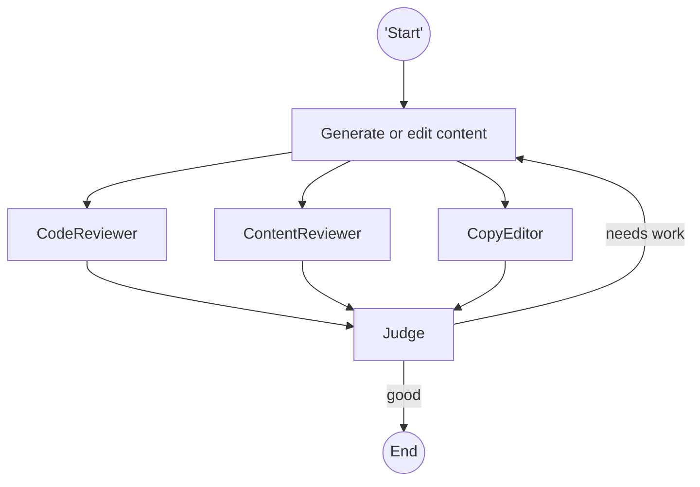
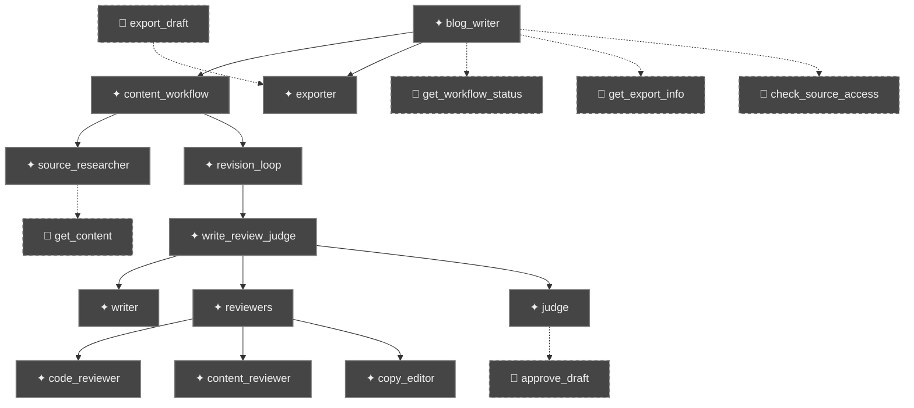

# Blog writer AI-agent

The AI-agent "blog-writer" was created using several iterations of code generation 
using OpenAI's Codex AI-agent -- see the documents ["prompts.md"](./docs/prompts.md).

The initial, basic structure of the agent is this one:

But that structure does not allow for reliable handling of meta queries for process status,
export of drafts or results, or self-knowledge / introspection. 
Hence, agent's underlying graph was extended to have an orchestrator and exporter nodes.

Here is the current graph: 

After several experiments using Ollama models (like, "gpt-oss:20b" or "nemotron-3.5-lightning:latest") 
or "big" OpenAI models ("gpt-5.6-terra" and "gpt-5.6-luna") certain manual tunings of the prompts in the nodes were made.
(And the results seem much better.)

