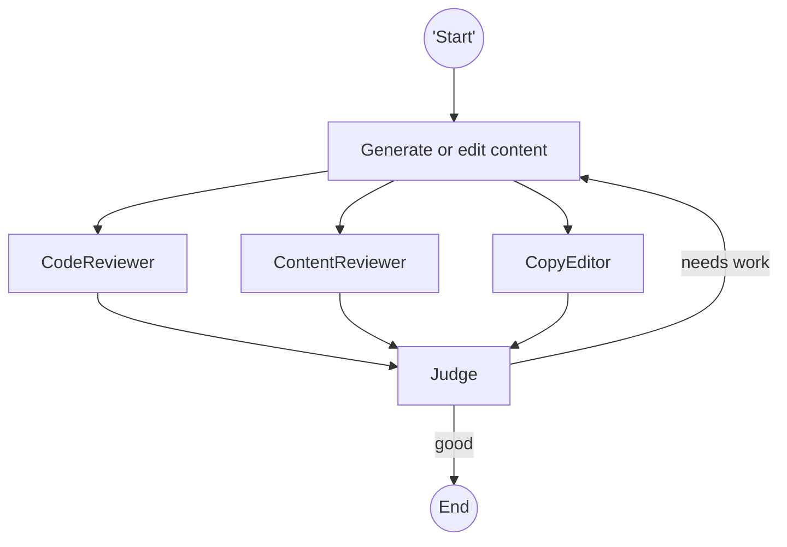

## Implementation 

````text
Generate the code of Google ADK agent that has the following graph structure:



Each node of the graph is separate LLM persona.
It has its own prompt or skill and LLM-access configuration.

The max iterations over the write-review-judge-edit loop should be specfied by the user, by default 4.
Keep track the reviews given by each personas. 

The end result should be Markdown text with code blocks.
````


```text
I assume the blog title and outline are entered by the user in agent's console. I want to have file path and/or URL as starting input. Tell me your plan for implementing this -- do not implement yet.
```

```text
Tell me your plan to:

1. Add exort node that writes down the final result or the draft pointed out by the user
2. Add an orchestrator node that helps answering general questions like:

- Is the final result ready?
- Where is the result file?
- Can you access this file?
- Can you dowload the content of this URL?
- How many revisions did you do?
```

```text
What happens when the context becomes too long in this agent?
```

```text
What exactly would you do for these three improvements you propose?
```